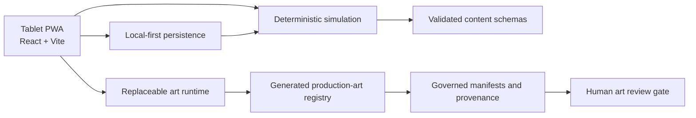

<div align="center">

# Pixel Pals

### Where every friendship changes the world.

A tablet-first, offline-capable storybook life simulation about friendship, family, community, identity, and cooperative discovery.

[](https://github.com/Knapp-Kevin/Pixel-Pal/actions/workflows/ci.yml)


[Quick start](#quick-start) · [Current build](#current-build) · [Architecture](#architecture) · [Verification](#verification) · [Art review](docs/art/review/rain-path/README.md) · [Roadmap](#roadmap)

</div>

---

## What Pixel Pals Is

Pixel Pals is a nonviolent life simulation where children discover anthropomorphic animal characters, welcome them into villages, build homes, nurture relationships, practice skills, explore cooperative adventures, and preserve the history of a changing community.

Pals are not weapons, units, disposable collectibles, or bundles of statistics. Each Pal is an individual with a home, relationships, preferences, memories, abilities, cultural influences, and a life that continues to develop.

The governing product principle is simple:

> **Every system strengthens relationships.**

A feature should deepen a friendship, support a family, enrich a community, preserve a memory, or help a Pal find where they belong. Features that do none of those things do not belong in the product merely because games have historically accumulated menus like lint.

## Current Build

Pixel Pals is a private engineering alpha. The core vertical slice is functional, installable, locally persistent, and protected by automated browser and release gates. It is not yet visually ready for public production.

| Area | Current state |
| --- | --- |
| Tablet application | React 19 and Vite PWA with touch-first responsive layouts |
| Starter Pals | Five selectable starter species with deterministic identities |
| Living world | Repeatable day flow, village state, homes, relationships, preferences, and memories |
| Activities | Leaf Chase, Stone Stacking, and Garden Game are active interactions rather than narrated outcomes |
| Adventures | The Lanterns in the Rain and The Humming Bridge support staged cooperative play |
| Persistence | Local-first world storage, multiple worlds, migrations, suspension recovery, and offline continuation |
| Accessibility | Reduced motion, readable touch targets, orientation coverage, keyboard paths, and accessibility profiles |
| Art runtime | Responsive production-art registry, live character overlays, fallback renderer, provenance, and human review gates |
| Performance | Emulated older-tablet budgets, image decode measurements, heap evidence, and installability checks |
| Production readiness | Blocked by final production art and physical target-tablet validation |

### Playable Vertical Slice

The current alpha proves the first meaningful relationship loop:

1. Choose and name a first Pal.
2. Enter Willowmere and meet Fern.
3. Participate in active shared activities.
4. Build friendship through repeated days and remembered choices.
5. Visit and personalize a home.
6. Complete cooperative illustrated adventures.
7. Review memories and world history in the journal.
8. Safely suspend, reload, or continue offline.

### Honest Limitations

The software pipeline is substantially ahead of the visual presentation.

- The modular fallback character renderer remains an alpha and development fixture.
- The current Rain Path images are simplified technical benchmarks, not production art.
- Final character model sheets, living-world atlases, environments, story illustrations, and motion assets remain incomplete.
- Physical compact and large tablet testing remains a release gate.
- Online accounts, cloud synchronization, analytics, social systems, and monetization are intentionally deferred pending explicit child-safety and privacy review.

## Art Review

The first responsive adventure-art benchmark is committed directly to this repository and can be reviewed without downloading CI artifacts.

<table>
  <tr>
    <th>Rain Path landscape benchmark</th>
    <th>Rain Path portrait benchmark</th>
  </tr>
  <tr>
    <td align="center">
      
    </td>
    <td align="center">
      
    </td>
  </tr>
</table>

These files validate responsive selection, crop behavior, browser decode, offline packaging, and performance. They remain `benchmark` assets with `humanArtApproval: false`.

See the [Rain Path repository review gallery](docs/art/review/rain-path/README.md) for direct source links, review criteria, status, and promotion requirements.

## Product Promise

Pixel Pals gives children a world where:

- kindness has visible consequences;
- differences create new possibilities;
- families can form in many ways;
- communities grow stronger through cooperation;
- identity is shaped by biology, environment, culture, experience, and choice;
- learning happens naturally through play;
- progress does not require violence, competition, gambling, or manipulation.

## Core Gameplay Loop

| Step | Player experience | World consequence |
| --- | --- | --- |
| Discover | Meet a Pal, family, village, place, or mystery | The known world expands |
| Welcome | Help someone find safety and belonging | The community gains a new individual |
| Build | Create homes and shared spaces | The village becomes more livable |
| Connect | Spend time, cooperate, converse, and resolve conflict | Relationships gain history and trust |
| Grow | Practice skills and develop confidence | Pals gain new ways to contribute |
| Explore | Complete cooperative storybook adventures | New stories, knowledge, and places emerge |
| Remember | Preserve milestones, keepsakes, and experiences | Personal history becomes village history |
| Transform | Combine relationships, skills, and cultures | The world visibly changes |

## Design Pillars

### Every Pal Is a Person

A Pal has an individual identity rather than a generic level. Species, lineage, inherited traits, environmental adaptation, culture, experience, personality, preferences, skills, relationships, memories, clothing, and choice remain distinct systems.

### Build Lives, Not Armies

Progress is measured through flourishing homes, stronger relationships, practiced skills, restored places, meaningful memories, and communities that become richer through cooperation.

### Diversity Creates Possibility

Different species, lineages, cultures, abilities, and experiences unlock new architecture, food, music, stories, traditions, exploration approaches, and community solutions. Diversity must change what the village can become, not merely add a numerical bonus.

### Genetics Is Not Destiny

Inheritance supports believable family resemblance and optional learning about genes, alleles, genotype, phenotype, dominance, recessiveness, and adaptation. Biology influences a Pal, but never determines culture, personality, worth, family belonging, or future choices.

### Wonder Without Doctrine

Great Trees, ancient places, regional essences, and quiet mysteries create a sense of wonder without representing or teaching a real-world religion.

### Learning Through Systems

Educational value comes from accurate, understandable systems rather than quizzes interrupting play. Genetics, biodiversity, ecology, probability, cooperation, empathy, cultural exchange, geography, and stewardship emerge through decisions and consequences.

## Great Trees

A Great Tree stands at the emotional center of each major village. It recognizes lasting connections such as friendship, companionship, marriage, adoption, mentorship, reconciliation, service, remembrance, and family formation.

The tree changes with the community. Its branches, blossoms, lanterns, carvings, and surrounding spaces become a visible record of the lives built nearby.

## Tablet-First Requirements

Tablet interaction is the source of truth.

- Landscape is the primary gameplay orientation, with supported portrait layouts.
- Core actions use comfortable touch targets and do not depend on hover.
- Drag interactions require tap-based alternatives.
- Text remains readable without browser zoom.
- Navigation stays shallow and avoids tiny inventory grids.
- Sessions support brief check-ins and longer shared play.
- Suspension, battery loss, refresh, and lost connectivity must not destroy progress.
- Static illustration is preferred over continuous heavy animation.
- Motion must be purposeful and reducible.
- Core play remains available offline after installation.

## Child Safety and Privacy

Child safety is an architectural constraint, not a policy page added after the telemetry vendor has already met everyone.

Pixel Pals defaults to:

- no advertising;
- no behavioral profiling;
- no loot boxes or gambling-like mechanics;
- no direct messaging with strangers;
- no public location sharing;
- no unnecessary personal information;
- no dark patterns intended to extend playtime;
- no purchase prompts directed at children.

Any future account, cloud save, analytics, social, or monetization capability requires explicit child-safety and privacy review before implementation. Parent-facing controls must remain clear, separate from child-facing play, and protected from accidental access.

## Architecture

Pixel Pals separates deterministic game state, persistence, rendering, schemas, and tablet presentation so each can evolve without turning the others into hostages.



### Architecture Principles

1. **Simulation is deterministic.** Equivalent inputs and seeds produce equivalent outcomes.
2. **Rendering is replaceable.** Game state does not depend on a specific art renderer.
3. **Content is data-driven.** Species, adventures, activities, memories, and traits use validated contracts.
4. **Offline is a first-class mode.** Network availability does not control core play.
5. **Accessibility is structural.** It is implemented with the product, not postponed until polish.
6. **Child safety shapes the data model.** Collection and social boundaries are constrained from the beginning.
7. **Art promotion is governed.** Technical validity cannot impersonate human visual approval.
8. **Legacy migration is selective.** Old code is reused only when it supports the current product direction.

## Repository Map

```text
Pixel-Pal/
├── apps/
│   └── tablet/                    Tablet-first React PWA
├── packages/
│   ├── content-schema/            Validated content contracts
│   ├── persistence/               Local-first saves and migrations
│   ├── renderer/                  Character and scene art resolution
│   └── simulation/                Deterministic world and relationship logic
├── art/
│   ├── production/                Governed source artwork
│   ├── review/                    Human review decisions and templates
│   ├── adventure-production-manifest.json
│   └── production-manifest.json
├── docs/
│   └── art/                       Art direction, asset contracts, and review policy
├── scripts/                       CI, browser, release, art, and evidence gates
└── .github/workflows/ci.yml       Locked verification pipeline
```

## Technology

| Layer | Technology |
| --- | --- |
| Language | TypeScript |
| Application | React 19 |
| Build and development | Vite 7 |
| PWA | vite-plugin-pwa |
| Testing | Vitest and browser-level Chrome DevTools Protocol scripts |
| Persistence | Local-first browser storage with versioned migration contracts |
| Art | Manifest-driven responsive WebP assets with a replaceable fallback renderer |
| Package management | npm workspaces |
| Runtime baseline | Node.js 22 or newer |

## Quick Start

### Prerequisites

- Node.js 22 or newer
- npm 10 or newer
- A modern Chromium-based browser for the full browser verification suite

### Install and Run

```bash
git clone https://github.com/Knapp-Kevin/Pixel-Pal.git
cd Pixel-Pal
npm ci
npm run dev
```

The development server starts the tablet application. Vite prints the local address in the terminal.

### Production Build

```bash
npm run build
npm run preview
```

### Installable PWA Verification

```bash
npm run build
npm run verify:artifacts
```

## Verification

The repository does not use “works on my machine” as an evidence class.

| Command | Verifies |
| --- | --- |
| `npm run typecheck` | TypeScript contracts across all workspaces |
| `npm test` | Unit and integration behavior |
| `npm run build` | Production tablet build |
| `npm run verify:artifacts` | Installable production build output |
| `npm run verify:deployment` | Deployment assumptions and required files |
| `npm run verify:viewports` | Tablet layouts, interactions, accessibility profiles, and screenshots |
| `npm run verify:suspension` | Safe save and resume behavior after lifecycle interruption |
| `npm run verify:adventures` | Both staged illustrated adventures across starter profiles |
| `npm run verify:worlds` | Multiple local worlds and catalog behavior |
| `npm run verify:performance` | Emulated older-tablet launch, interaction, reload, and heap budgets |
| `npm run verify:art-plan` | Honest planned, benchmark, approved, and production manifest states |
| `npm run verify:art-reviews` | Human review decisions, exact file digests, provenance, and promotion integrity |
| `npm run verify:art-registry` | Generated runtime registry matches eligible manifest entries |
| `npm run generate:art-review` | Repository art-review evidence page |
| `npm run verify:production-art` | Strict release gate requiring all release assets in production state |

### Full Local Gate

```bash
npm ci --no-audit --no-fund
npm audit --omit=dev --audit-level=high
npm run verify:art-plan
npm run verify:art-reviews
npm run verify:art-registry
npm run typecheck
npm test
npm run build
npm run verify:artifacts
```

Browser verification commands require a running preview server and are executed automatically by CI.

## Production Art Governance

Production artwork follows a deliberate state model:

```text
planned -> benchmark -> approved -> production
```

- `planned` reserves an honest empty slot.
- `benchmark` permits technical pipeline and performance validation.
- `approved` requires a named human reviewer, complete criteria, exact file digests, and matching provenance.
- `production` requires final release review and physical tablet validation.

Landscape and portrait assets are one responsive unit. Half-promoted pairs fail validation. AI systems and automation may prepare evidence, but they cannot satisfy the named human approval requirement.

Primary art documentation:

- [Production Art Plan](docs/art/PRODUCTION_ART_PLAN.md)
- [Production Asset Contract](docs/art/PRODUCTION_ASSET_CONTRACT.md)
- [Rabbit and Fern Visual Benchmark](docs/art/RABBIT_FERN_VISUAL_BENCHMARK.md)
- [Human Art Review and Promotion](docs/art/HUMAN_ART_REVIEW_AND_PROMOTION.md)
- [Rain Path Review Gallery](docs/art/review/rain-path/README.md)

## Offline and Save Model

Core play is local-first.

The save model supports deterministic world state, durable local persistence, versioned migrations, multiple worlds, suspension recovery, and continued offline play. Cloud services may later improve continuity, but they must not become mandatory for the child-facing core experience.

## Legacy Migration Policy

The earlier `pixel-pal-paradise-creations` repository remains a reference implementation, not a code donor with diplomatic immunity.

Migration candidates must prove that they:

1. strengthen relationships;
2. support tablet-first play;
3. remain understandable to a child;
4. respect privacy and safety;
5. are maintainable without legacy orchestration baggage;
6. support the current product identity.

## Roadmap

### Completed Foundation

- deterministic simulation and content boundaries;
- installable tablet PWA shell;
- local-first persistence and multiple worlds;
- repeatable day and relationship rhythm;
- active shared activities;
- two staged cooperative adventures;
- accessibility and responsive viewport matrix;
- suspension, offline, performance, and installability gates;
- manifest-driven responsive art runtime;
- human art-review enforcement.

### Current Priority

1. Replace the technical Rain Path pair with coherent painterly landscape and portrait art.
2. Complete human visual, accessibility, originality, rights, crop, and tablet review.
3. Produce and approve the Rabbit and Fern benchmark board.
4. Lock anatomy, rendering, texture, lighting, line treatment, and expression standards.
5. Bring all five starter species and Fern to equivalent production quality.
6. Validate approved assets on physical compact and large target tablets.

### Following Milestones

- first-session Willowmere, Great Tree, home, and activity scene kits;
- finished first-meeting, activity, ceremony, home, and memory illustrations;
- animation and reduced-motion asset contracts;
- broader skills, characteristics, family, inheritance, and regional systems;
- parent-managed continuity features only after safety and privacy design review.

## Definition of Done

A feature is not complete until it includes, where applicable:

- child-readable UX;
- comfortable touch interaction;
- keyboard and assistive-technology support;
- reduced-motion behavior;
- offline and lifecycle behavior;
- persistence and migration behavior;
- tests for critical logic;
- documentation for new contracts;
- privacy and safety review for data or social behavior;
- evidence that it strengthens the product North Star.

## Contribution Expectations

Pixel Pals is currently a private MythologIQ Labs, LLC project in active development.

Changes should favor:

- clarity over cleverness;
- deterministic systems over opaque behavior;
- accessible interfaces over visual density;
- meaningful choices over repetitive grinding;
- durable evidence over undocumented confidence;
- small, reviewable changes over speculative rewrites;
- honest status over premature production claims.

## Guiding Questions

Before adding or changing a system, ask:

- Which relationship becomes stronger because this exists?
- What does the child understand through play?
- What changes visibly in the world?
- Can the child safely stop at any time?
- Does this work on a tablet without explanation?
- Does this preserve wonder without sacrificing coherence?
- Does this help a Pal, family, or village flourish?

---

<div align="center">

**Pixel Pals**

**Where every friendship changes the world.**

</div>
